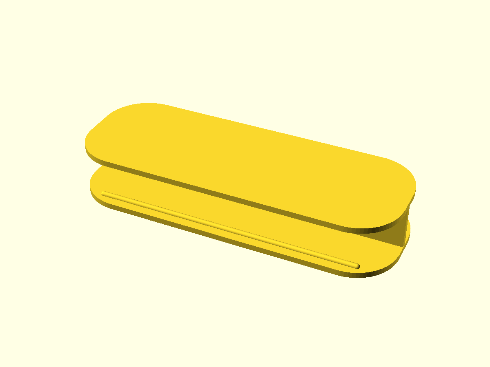

# ikea-eilif-screen-connector

IKEA EILIF 스크린(책상 파티션) 두 장을 잇는 커넥터입니다.

MakerWorld: [IKEA EILIF 스크린 커넥터](https://makerworld.com/ko/models/2495648-ikea-eilif-screen-connector) (2026-03-08 공개)

## 치수

전체 크기는 110.1 x 40 x 19mm입니다. 치수는 scad 파일 맨 위 변수로 바꿉니다.

| 변수 | 값 (mm) | 뜻 |
|---|---|---|
| `gap` | 15 | 위아래 판 사이 간격 (스크린이 끼는 자리) |
| `plate_thick` | 2 | 판 두께 |
| `web_thick` | 2 | 가운데 벽 두께 |
| `width` | 40 | 너비 |
| `flat_length` | 80 | 평평한 구간 길이 |
| `ridge_visible_h` | 1.0 | 안쪽 돌기 높이 |

## 출력

MakerWorld에 올린 프로필과 같은 설정입니다. `out/ikea-eilif-screen-connector.3mf`가 그 Bambu Studio 프로젝트입니다.

- Bambu Lab A1, 0.4mm 노즐, 0.20mm Standard, PLA Basic
- 벽 2겹, 채움 15%, 서포트 없음

## 파일 출처

2026-03-08에 만든 `eilif.scad`와 `eilif-connector.3mf`를 이름만 바꿔 옮겼습니다. 소스 내용은 그대로이고, 내보낸 STL이 당시 STL과 삼각형 수(13,788개)와 크기가 같은 것을 확인했습니다.
