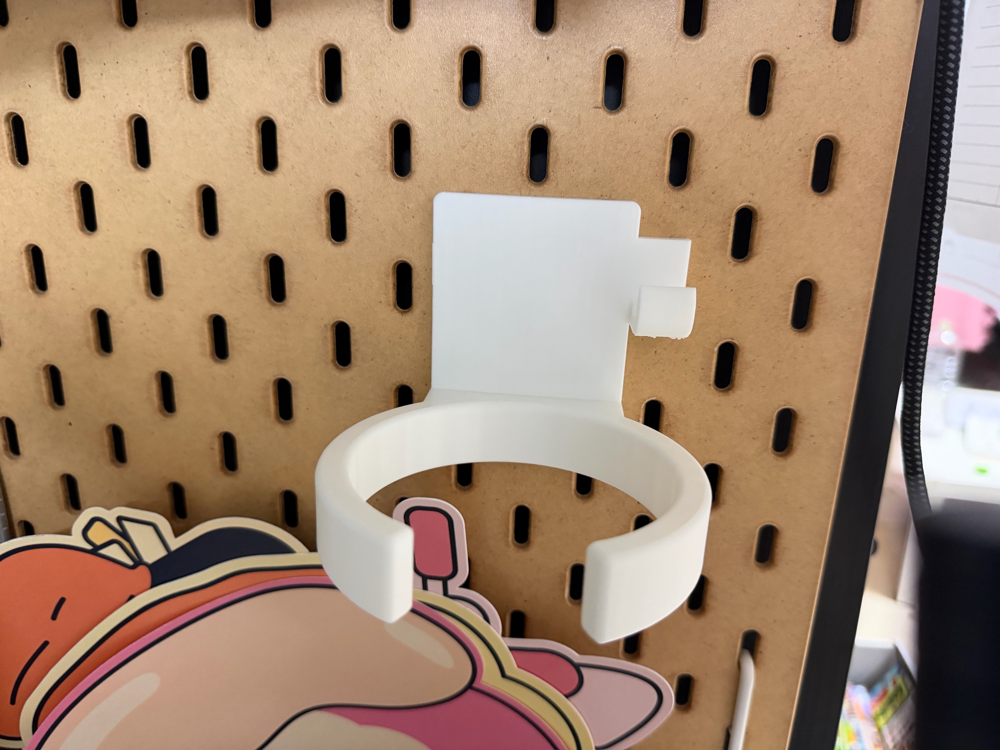
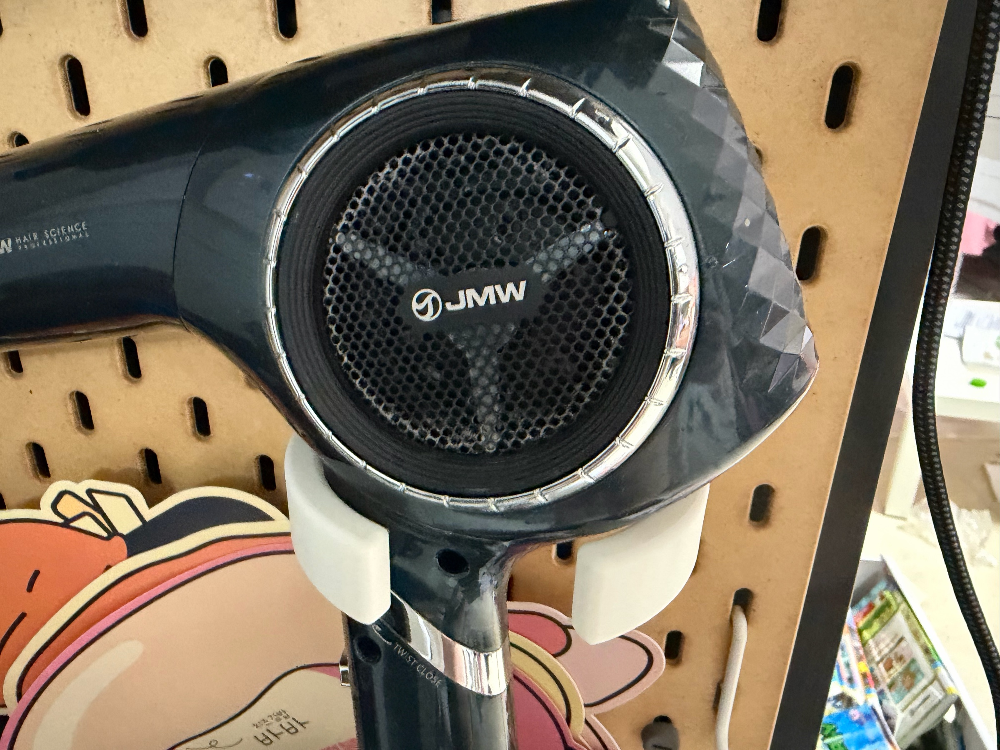
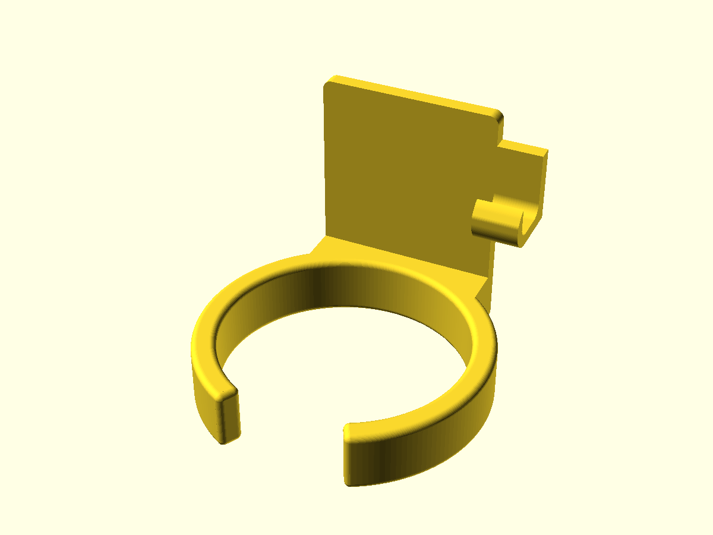

# skadis-hair-dryer-holder

IKEA SKÅDIS 타공판에 거는 헤어드라이어 거치대입니다.







요청 프롬프트 원문은 [prompt.md](prompt.md)에 있습니다.

## 치수

| 부분 | 치수 (mm) |
|---|---|
| 뒤판 | 너비 60, 높이 80, 두께 5, 모서리 둥글기 3 |
| SKÅDIS 걸이 | 2개, 중심 간격 40, 너비 4.8, 뒤판과 걸림턱 사이 틈 4.8, 걸림턱 길이 10 |
| 드라이어 링 | 안지름 80, 벽 두께 8, 높이 20, 앞쪽 트임 35, 모서리 둥글기 2 |
| 코드 걸이 | 뒤판 오른쪽 옆, 너비 15, 깊이 20 |

전체 크기는 96 x 103.5 x 80입니다.

요청 사양에 없어서 정한 값은 다음과 같습니다. 모두 scad 파일 맨 위 변수입니다.

- 걸림턱 두께 3, 목 높이 4.8, 걸이 윗면 높이 70
- 걸림턱 길이 10은 걸이 윗면에서 아래로 잰 전체 길이입니다. 목 아래로는 5.2 내려옵니다. 높이 15인 타공 슬롯에 넣을 여유를 두려고 이렇게 잡았습니다.
- 링 트임 35는 양 끝 둥글기를 포함해 가장 좁은 곳 기준입니다.
- 코드 걸이 깊이 20은 뒤판 앞면에서 앞으로 나온 길이입니다. 살 두께 4, 턱 높이 12입니다.

## 출력

- 방향: 사용할 때 자세 그대로 세워서 출력합니다(`print_orientation = "upright"`). 링과 뒤판 바닥이 베드에 닿습니다.
- 서포트: 뒷면 걸이 2개와 코드 걸이 아래에 필요합니다. 코드 걸이 앞쪽 끝 일부(약 21mm²)는 링 벽 바로 위에 있어서, 베드에서 올라오는 서포트만 켜면 그 부분은 빠집니다. 서포트 범위를 전체로 두거나 그 부분은 서포트 없이 출력합니다.
- 뒷면이나 옆면을 바닥에 두려면 `-D 'print_orientation="back"'` 또는 `"side"`로 내보냅니다.

요청 사양은 옆면이나 뒷면을 바닥에 두는 방향이었지만, 세 방향의 오버행 면적을 측정해 보니 세운 자세가 가장 작아서 기본값으로 정했습니다. 수평에서 45도보다 누운 아랫면의 넓이이고, 베드에 닿는 면은 뺐습니다.

| 방향 | 오버행 면적 (mm²) | 비고 |
|---|---|---|
| upright (세운 자세) | 1152 | 이 중 729는 링과 뒤판의 바닥 둥글기로, 베드에서 2mm 안쪽 |
| side (왼쪽 옆면이 아래) | 3505 | 링이 아치처럼 선다 |
| back (뒷면이 아래) | 5924 | 걸이 때문에 뒤판 전체가 베드에서 뜬다 |

코드 걸이는 링 중심축에서 가장 가까운 곳이 41mm로, 링 안쪽 벽(반지름 40)보다 1mm 바깥입니다. 드라이어 몸통이 링 위에서 지름 82mm보다 넓어지면 코드 걸이에 닿을 수 있습니다.

## SKÅDIS 판 맞춤

걸이 틈(`hook_depth`) 4.8로 출력한 것이 실제 SKÅDIS 판에 잘 걸렸습니다(Bambu Lab A1, 0.4mm 노즐, PLA, 2026-11-25). 판에 따라 빡빡하면 틈을 넓혀서 내보냅니다.

```sh
scripts/export.sh skadis-hair-dryer-holder -D hook_depth=5.2
```
